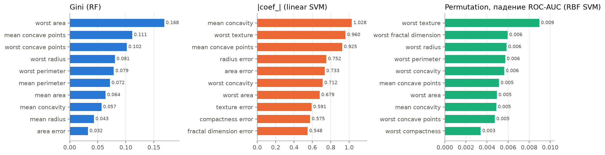
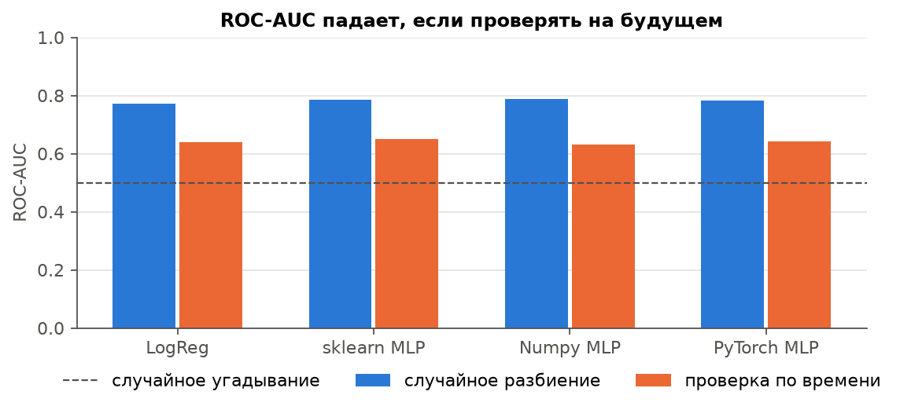
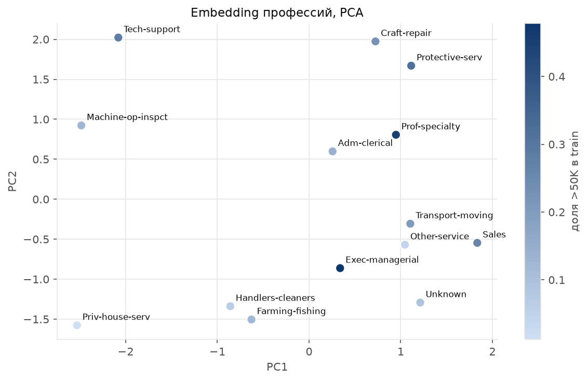

<div align="center">

# Tabular ML Studies

**Three end-to-end studies on tabular data, each with a clean train / val / test protocol, statistical tests on the differences, and an honest answer to "which model should I actually ship?".**


English · [Русский](README.ru.md)

</div>

---

| Study | Data | Question | Answer |
|---|---|---|---|
| [**Breast cancer: RF vs SVM**](breast-cancer-rf-vs-svm) | Wisconsin Diagnostic, 569 patients | Which model misses fewer tumours, when a missed tumour costs 20× a false alarm? | RBF-SVM: cost 43 vs 60, recall 0.94 vs 0.91 |
| [**Bank marketing: an MLP in pure NumPy**](bank-marketing-numpy-mlp) | UCI Bank Marketing, 45,211 calls | Does a hand-written neural net beat logistic regression, and do the numbers survive a time split? | Yes, slightly (PR-AUC 0.447 vs 0.424, significant), and no: ROC-AUC drops to 0.63–0.65 on later data |
| [**Adult income: nets with PLE vs boosting**](adult-income-ple-nets) | Adult Census, 48,842 people | Can a custom wide & deep net with learned embeddings catch gradient boosting? | Not quite: 0.820 vs 0.831 PR-AUC. The biggest gain came from the number encoding (PLE, +0.03), not the architecture. |

---

## 1 · Breast cancer: Random Forest vs SVM

- Stratified 70/15/15 split. GridSearchCV is scored on recall, and the selection rule (**recall at precision ≥ 0.9**, ties broken by CV recall) was fixed **before** the test set was touched.
- The **cost-sensitive metric** is `Cost = 1·FP + 20·FN`. Repeated cross-validation confirms the direction of the test result, although 32 positive test cases cannot prove it on their own.
- **Feature importance in three ways**: Gini, permutation and linear SVM coefficients, plus **grouped permutation** (size, contour shape, texture), because correlated duplicates split Gini importance between them.
- **Scalability benchmark**: kernel SVM training grows almost quadratically, while the forest grows linearly and parallelises.

| Test | ROC-AUC | Recall | Precision | Cost |
|---|---:|---:|---:|---:|
| Random Forest | 0.999 | 0.906 | 1.000 | 60 |
| **SVM (RBF)** | 0.996 | **0.938** | 0.909 | **43** |
| SVM, class-balanced (extra) | 1.000 | 0.969 | 1.000 | 20 |

**Takeaway:** SVM for small clinical data, Random Forest for millions of rows and for explaining the model to a doctor.

<p align="center"></p>

## 2 · Bank marketing: an MLP written in NumPy

- **`NumpyMLP` from scratch**: forward and backward pass, ReLU / tanh, He / Xavier initialisation, Adam, L2, mini-batches and early stopping. Only NumPy is used. It is checked against sklearn's `MLPClassifier` and an identical PyTorch net.
- Leakage removed (`duration` is only known after the call). The main metric is **PR-AUC** (11.7% positives), plus a business metric: **the share of subscribers captured by calling the top 20%** of clients.
- **Paired bootstrap** on the test set and **seed-stability** runs. The **temporal check** (train on earlier rows, test on later ones) is the most important result.

| Test | PR-AUC | ROC-AUC | Captured in top 20% |
|---|---:|---:|---:|
| Dummy | 0.117 | 0.500 | 18.7% |
| Logistic regression | 0.424 | 0.771 | 57.1% |
| sklearn MLP | 0.436 | 0.784 | 60.2% |
| PyTorch MLP | 0.442 | 0.783 | 60.8% |
| **NumPy MLP (mine)** | **0.447** | **0.789** | **60.8%** |

**Takeaway:** the hand-written net matches the libraries and is statistically better than logistic regression. On a time split, however, every model drops to ROC-AUC 0.63–0.65, so I would ship the logistic regression and retrain it regularly.

<p align="center"></p>

## 3 · Adult income: neural nets with PLE vs gradient boosting

- Baselines: logistic regression, Random Forest, Gradient Boosting (tuned).
- Three networks: a simple MLP, a deep MLP with BatchNorm and Dropout, and **my own wide & deep net**. It combines a linear "wide" part with a deep part built on **learned categorical embeddings** (fastai sizing rule) and **residual blocks**, and an ablation switches off each part in turn.
- **Piecewise linear encoding (PLE)** of numeric features, with bins taken from tree splits. Every net is trained with 5 seeds, and the differences are checked with a **paired bootstrap** (2,000 resamples).

| Test | PR-AUC | ROC-AUC | F1 |
|---|---:|---:|---:|
| **Gradient Boosting** | **0.831** | **0.931** | **0.735** |
| My wide & deep net (PLE) | 0.820 ± 0.002 | 0.926 | 0.723 |
| Simple net + PLE | 0.819 ± 0.001 | 0.925 | 0.724 |
| Random Forest | 0.807 | 0.920 | 0.712 |
| Logistic regression | 0.792 | 0.917 | 0.706 |
| Simple net (one-hot) | 0.789 ± 0.001 | 0.917 | 0.706 |

**Takeaway:** boosting is still the right default for this kind of data. For neural nets, **how the numbers are represented matters more than depth**: PLE lifted every net by about 0.03 PR-AUC, and after that the custom architecture gave no proven gain over a simple net.

<p align="center"></p>

## Run any study

```bash
cd <study-folder>
python -m venv .venv && source .venv/bin/activate
pip install -r requirements.txt
jupyter nbconvert --to notebook --execute --inplace notebooks/*.ipynb
```

The breast cancer data ships with scikit-learn, Bank Marketing is included in `data/raw/`, and Adult is downloaded from OpenML on the first run. Run times: about 1, 12 and 20–30 minutes on a laptop CPU. Every notebook is committed with outputs, and each folder has a full write-up in `REPORT.ru.md` (in Russian).

## License

[MIT](LICENSE). Datasets belong to their owners (UCI Machine Learning Repository, CC BY 4.0).
