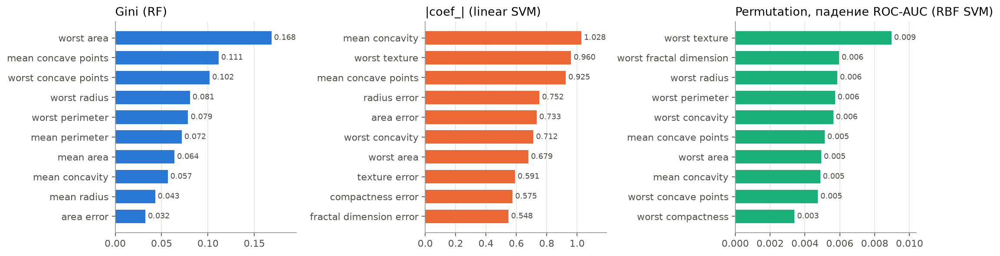
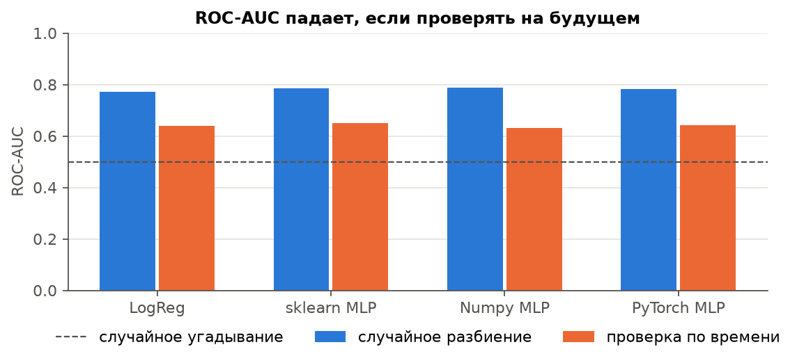
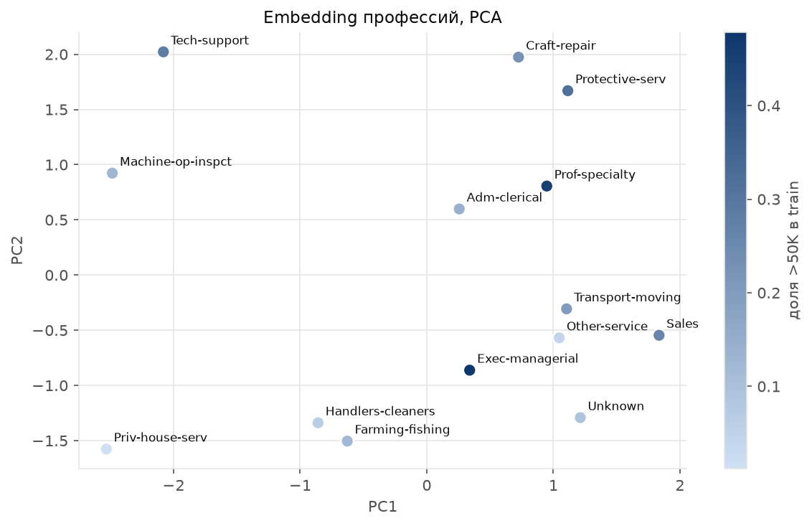

<div align="center">

# Tabular ML Studies

**Три сквозных исследования на табличных данных. В каждом чистый протокол train / val / test, статистическая проверка разниц и честный ответ на вопрос «какую модель реально выкатывать?».**


[English](README.md) · Русский

</div>

---

| Исследование | Данные | Вопрос | Ответ |
|---|---|---|---|
| [**Рак груди: RF против SVM**](breast-cancer-rf-vs-svm) | Wisconsin Diagnostic, 569 пациентов | Какая модель пропускает меньше опухолей, если пропуск в 20 раз дороже ложной тревоги? | SVM с RBF: цена ошибок 43 против 60, recall 0.94 против 0.91 |
| [**Банковский маркетинг: MLP на чистом NumPy**](bank-marketing-numpy-mlp) | UCI Bank Marketing, 45 211 звонков | Обходит ли написанная вручную сеть логистическую регрессию и переживают ли цифры разбиение по времени? | Да, немного (PR-AUC 0.447 против 0.424, значимо). И нет: на поздних данных ROC-AUC падает до 0.63–0.65 |
| [**Доход Adult: сети с PLE против бустинга**](adult-income-ple-nets) | Adult Census, 48 842 человека | Догонит ли своя wide & deep сеть с обучаемыми embeddings градиентный бустинг? | Почти: 0.820 против 0.831 PR-AUC. Больше всего дало кодирование чисел (PLE, +0.03), а не архитектура |

---

## 1 · Рак груди: Random Forest против SVM

- Стратифицированное разбиение 70/15/15. GridSearchCV оптимизирует recall, а правило выбора (**recall при precision ≥ 0.9**, при равенстве — больший CV recall) зафиксировано **до** первого взгляда на тест.
- **Метрика с ценой ошибок:** `Cost = 1·FP + 20·FN`. Повторная кросс-валидация подтверждает направление результата на тесте, хотя 32 положительных случая в тесте сами по себе его не доказывают.
- **Важность признаков тремя способами:** Gini, permutation и коэффициенты линейного SVM, плюс **групповая permutation** (размер, форма контура, текстура), потому что коррелированные дубли делят Gini-важность между собой.
- **Бенчмарк масштабируемости:** обучение kernel-SVM растёт почти квадратично, лес растёт линейно и распараллеливается.

| Test | ROC-AUC | Recall | Precision | Cost |
|---|---:|---:|---:|---:|
| Random Forest | 0.999 | 0.906 | 1.000 | 60 |
| **SVM (RBF)** | 0.996 | **0.938** | 0.909 | **43** |
| SVM с балансом классов (доп.) | 1.000 | 0.969 | 1.000 | 20 |

**Итог:** SVM для небольших медицинских данных, Random Forest — для миллионов строк и когда модель нужно объяснить врачу.

<p align="center"></p>

## 2 · Банковский маркетинг: MLP на NumPy

- **`NumpyMLP` с нуля:** прямой и обратный проход, ReLU / tanh, инициализация He / Xavier, Adam, L2, мини-батчи и early stopping. Используется только NumPy. Сверяется с `MLPClassifier` из sklearn и такой же сетью на PyTorch.
- Утечка убрана: `duration` известна только после звонка. Главная метрика — **PR-AUC** (11.7% положительных), плюс бизнес-метрика: **доля подписавшихся, которых ловят звонки топ-20%** клиентов.
- **Парный bootstrap** на тесте и проверка **стабильности по seed**. Самый важный результат — **проверка по времени** (обучение на ранних строках, тест на поздних).

| Test | PR-AUC | ROC-AUC | Захват топ-20% |
|---|---:|---:|---:|
| Dummy | 0.117 | 0.500 | 18.7% |
| Логистическая регрессия | 0.424 | 0.771 | 57.1% |
| sklearn MLP | 0.436 | 0.784 | 60.2% |
| PyTorch MLP | 0.442 | 0.783 | 60.8% |
| **NumPy MLP (своя)** | **0.447** | **0.789** | **60.8%** |

**Итог:** своя сеть не уступает библиотечным и статистически лучше логистической регрессии. Но при разбиении по времени все модели падают до ROC-AUC 0.63–0.65, поэтому в работу я бы взял логистическую регрессию и регулярно её переобучал.

<p align="center"></p>

## 3 · Доход Adult: нейросети с PLE против градиентного бустинга

- Baseline-модели: логистическая регрессия, Random Forest, Gradient Boosting (с тюнингом).
- Три сети: простой MLP, глубокий MLP с BatchNorm и Dropout и **своя wide & deep сеть**. В ней линейная «wide»-часть сочетается с глубокой частью на **обучаемых embeddings категорий** (правило размера из fastai) и **residual-блоках**, а ablation по очереди отключает каждую часть.
- **Кусочно-линейное кодирование (PLE)** числовых признаков с границами из сплитов дерева. Каждая сеть обучена на 5 seed, разницы проверены **парным bootstrap** (2000 повторов).

| Test | PR-AUC | ROC-AUC | F1 |
|---|---:|---:|---:|
| **Gradient Boosting** | **0.831** | **0.931** | **0.735** |
| Своя wide & deep сеть (PLE) | 0.820 ± 0.002 | 0.926 | 0.723 |
| Простая сеть + PLE | 0.819 ± 0.001 | 0.925 | 0.724 |
| Random Forest | 0.807 | 0.920 | 0.712 |
| Логистическая регрессия | 0.792 | 0.917 | 0.706 |
| Простая сеть (one-hot) | 0.789 ± 0.001 | 0.917 | 0.706 |

**Итог:** для таких данных бустинг остаётся правильным выбором по умолчанию. Для нейросетей **представление чисел важнее глубины**: PLE поднял все сети примерно на 0.03 PR-AUC, а после этого своя архитектура не дала доказанного выигрыша над простой сетью.

<p align="center"></p>

## Запуск любого исследования

```bash
cd <папка-исследования>
python -m venv .venv && source .venv/bin/activate
pip install -r requirements.txt
jupyter nbconvert --to notebook --execute --inplace notebooks/*.ipynb
```

Данные о раке груди встроены в scikit-learn, Bank Marketing лежит в `data/raw/`, Adult скачивается с OpenML при первом запуске. Время прогона на CPU ноутбука: около 1, 12 и 20–30 минут. Все ноутбуки закоммичены с выводами, в каждой папке лежит подробный отчёт `REPORT.ru.md`.

## Лицензия

[MIT](LICENSE). Датасеты принадлежат их владельцам (UCI Machine Learning Repository, CC BY 4.0).
