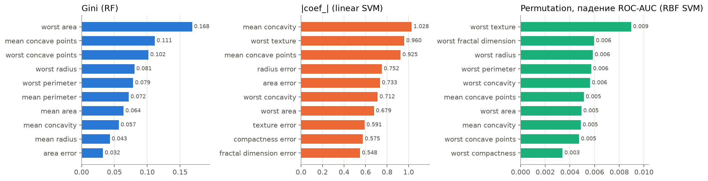
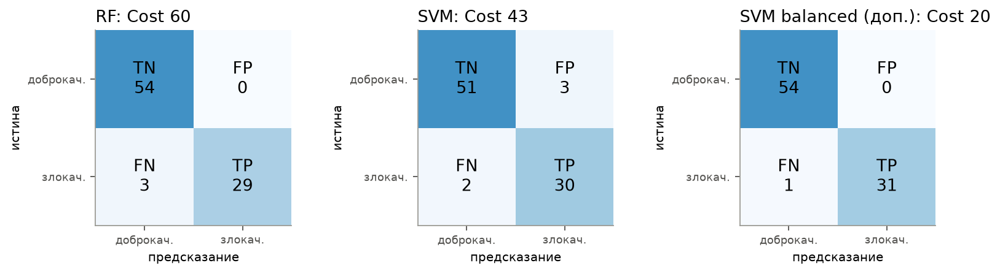

# Подробный отчёт: Random Forest vs SVM + Feature Importance

**Вывод.** По правилу выбора (Recall при Precision ≥ 0.9) и цене ошибок лучше SVM с RBF-ядром: на тесте Recall 0.938 и Cost 43 против 0.906 и 60 у Random Forest. Разница на 86 пациентах статистически не доказана, но повторная кросс-валидация показывает то же направление. Для малых медицинских данных подойдёт SVM, для миллионов записей Random Forest. Врачу проще объяснить Random Forest.

Код и графики: [notebooks/rf_vs_svm.ipynb](notebooks/rf_vs_svm.ipynb). Все таблицы: `results/tables/`. Все расчёты: scikit-learn 1.9.1, `random_state=42`.

## 1. Подготовка данных

Датасет Breast Cancer Wisconsin: 569 строк, 30 числовых признаков, пропусков и дублей нет, 212 злокачественных (37.3%). Метка инвертирована: 1 = malignant.

| Сплит | Строк | Злокачественных | Доля |
|---|---:|---:|---:|
| train | 398 | 148 | 0.372 |
| val | 85 | 32 | 0.376 |
| test | 86 | 32 | 0.372 |

StandardScaler находится внутри Pipeline и обучается только на train.

**Эффект масштабирования (val):**

| Модель | ROC-AUC | Recall | Precision | F1 | Cost |
|---|---:|---:|---:|---:|---:|
| SVM без scaler | 0.972 | 0.688 | 1.000 | 0.815 | 200 |
| SVM + StandardScaler | 0.996 | 0.875 | 1.000 | 0.933 | 80 |

Без масштабирования расстояния в RBF-ядре определяются признаками площади с самыми большими значениями, поэтому SVM пропускает на 6 опухолей больше.

## 2. Базовые модели (val)

| Модель | ROC-AUC | Recall | Precision | F1 | Время, с |
|---|---:|---:|---:|---:|---:|
| Dummy (самый частый класс) | — | 0.000 | — | — | — |
| Random Forest | 0.994 | 0.906 | 1.000 | 0.951 | ≈0.10 |
| SVM (RBF) + scaler | 0.996 | 0.875 | 1.000 | 0.933 | ≈0.003 |

Лучший Recall при высоком Precision у Random Forest: он находит на одну опухоль больше. Accuracy у Dummy равна 0.624 при нуле найденных опухолей, поэтому accuracy здесь не подходит.

## 3. Настройка гиперпараметров

GridSearchCV: cv=5, scoring="recall". Сетки: RF — n_estimators [100, 300], max_depth [None, 5, 10], max_features [sqrt, 0.5], min_samples_leaf [1, 3]. SVM — kernel [linear, rbf], C [0.1, 1, 10, 100], gamma [scale, 0.01, 0.1].

| № | Модель | Параметры | CV Recall | Val Recall | Val Precision | Время, с |
|---:|---|---|---:|---:|---:|---:|
| 1 | RF | по умолчанию | 0.925 | 0.906 | 1.000 | ≈0.10 |
| 2 | RF | лучшие из GridSearchCV (совпали с дефолтом) | 0.925 | 0.906 | 1.000 | ≈0.10 |
| 3 | SVM | kernel=linear, C=1 | 0.918 | 0.906 | 1.000 | ≈0.003 |
| 4 | SVM | kernel=rbf, C=1, gamma=scale | 0.945 | 0.875 | 1.000 | ≈0.003 |
| **5** | **SVM** | **лучшие из GridSearchCV: rbf, C=1, gamma=0.1** | **0.945** | **0.906** | **0.935** | **≈0.003** |
| доп. | SVM | rbf, C=1, gamma=scale, class_weight=balanced | 0.952 | 0.969 | 0.969 | ≈0.003 |

**Выбор.** Лучшая модель по Recall при Precision ≥ 0.9: строка 5. Строки 1, 2, 3 и 5 делят Val Recall 0.906. Исходный критерий не задаёт правила для равенства, поэтому до запуска теста выбран критерий: больший CV Recall.

**Особенности поиска.** У RF 16 из 24 комбинаций делят первое место (ничья, а не найденный оптимум). У SVM первое место делят {C=1, gamma=0.1} и {C=10, gamma=scale}.

**Повторная кросс-валидация** (train + val, 10 повторов по 5 фолдов, среднее ± std):

| Модель | Recall | Precision | Cost на 483 пациентах |
|---|---:|---:|---:|
| RF | 0.926 ± 0.011 | 0.959 ± 0.006 | 275 ± 38 |
| SVM (строка 5) | 0.948 ± 0.007 | 0.937 ± 0.008 | 200 ± 24 |
| SVM balanced (доп.) | 0.955 ± 0.005 | 0.953 ± 0.009 | 171 ± 17 |

## 4. Важность признаков

| Место | Gini (RF) | \|coef_\| (linear SVM) | Permutation (RBF SVM) |
|---:|---|---|---|
| 1 | worst area (0.168) | mean concavity (1.028) | worst texture (0.009) |
| 2 | mean concave points (0.111) | worst texture (0.960) | worst fractal dimension (0.006) |
| 3 | worst concave points (0.102) | mean concave points (0.925) | worst radius (0.006) |
| 4 | worst radius (0.081) | radius error (0.752) | worst perimeter (0.006) |
| 5 | worst perimeter (0.079) | area error (0.733) | worst concavity (0.006) |

**Принцип permutation importance.** На отложенной выборке перемешивается один столбец, модель не переобучается. Чем сильнее падает метрика (здесь ROC-AUC), тем сильнее модель опиралась на признак.

**Совпадения топ-5.** Общих для всех трёх методов нет. Попарно: Gini и coef_ делят `mean concave points`; Gini и permutation делят `worst radius`, `worst perimeter`; coef_ и permutation делят `worst texture`.

**Влияние коррелированных признаков.** Корреляция `mean radius` и `mean perimeter` равна 0.998. Важность делится между дублёрами, а знаки коэффициентов становятся ненадёжными: у 10 из 30 признаков знак coef_ противоречит сравнению средних по классам. Перестановка одного признака у RBF SVM роняет ROC-AUC максимум на 0.009, потому что дублёр остаётся целым. Групповая перестановка показывает настоящий вклад:

| Группа признаков | Падение ROC-AUC, RBF SVM | Падение ROC-AUC, RF |
|---|---:|---:|
| Размер (radius, perimeter, area) | 0.139 | 0.144 |
| Форма контура (concavity, concave points, compactness) | 0.055 | 0.060 |
| Текстура (texture) | 0.016 | 0.007 |
| Прочее (smoothness, symmetry, fractal dimension) | 0.014 | 0.001 |

**Предметный смысл.** Вероятность злокачественной опухоли выше у крупных ядер с вогнутым неровным контуром и неоднородной текстурой. Это связь в данных, а не доказанная причина.

## 5. Финальная оценка на тесте

Финалисты выбраны на val. Тест использован один раз. Cost = 1 · FP + 20 · FN.

| Модель | ROC-AUC | Recall | Precision | FP | FN | Cost | Время, с |
|---|---:|---:|---:|---:|---:|---:|---:|
| Random Forest | 0.999 | 0.906 | 1.000 | 0 | 3 | 60 | ≈0.10 |
| SVM (RBF, C=1, gamma=0.1) | 0.996 | 0.938 | 0.909 | 3 | 2 | 43 | ≈0.003 |
| SVM balanced (доп., вне основной сетки) | 1.000 | 0.969 | 1.000 | 0 | 1 | 20 | ≈0.003 |

У RF выше ROC-AUC и Precision, у SVM выше Recall и ниже Cost, потому что пропуск в 20 раз дороже ложной тревоги. Интервал бутстрапа (95%) для Cost(RF) − Cost(SVM): от −44 до +80, то есть на этой выборке различие не доказано. Пациента 99 пропустили все три модели.

**Масштабируемость** (синтетика, 30 признаков, время обучения в секундах):

| Строк | RF | SVM |
|---:|---:|---:|
| 1 000 | 0.24 | 0.02 |
| 4 000 | 1.08 | 0.20 |
| 16 000 | 6.01 | 2.29 |
| 32 000 | 14.90 | 10.52 |

Время растёт примерно как n^1.2 у RF и n^1.8 у SVM.

## 6. Выводы

**Какая модель предпочтительнее для небольших медицинских данных?** SVM: обучается за миллисекунды, находит больше опухолей, веса классов и порог легко настроить под цену ошибки. Обязателен StandardScaler. RF сравним по качеству и не требует масштабирования.

**Какая для миллионов записей?** Random Forest. Обучение kernel-SVM растёт почти квадратично, а предсказание зависит от числа опорных векторов. Лес растёт почти линейно и распараллеливается.

**Какую модель проще объяснить врачу?** Random Forest: рейтинг признаков, для отдельного пациента SHAP. Объяснять лучше группами признаков (размер, форма контура, текстура), потому что Gini не показывает направление и делит важность между дублёрами.

**Ограничения.** Один датасет, 32 опухоли в тесте: одна ошибка меняет Recall на 0.031. Модель не заменяет врача и не прошла внешнюю проверку. Дополнительная модель с `class_weight=balanced` показала лучший результат, но её преимущество нужно подтвердить на независимых данных.

## 7. Сверка с эталоном

Результаты совпали с эталонными значениями: размеры и доли сплитов, метрики на val и test, лучшие параметры, топ-5 Gini и coef_. Нижняя граница топ-5 permutation равна 0.0056, в эталоне указано 0.005. Полная таблица: `results/tables/reference_check.csv`.
